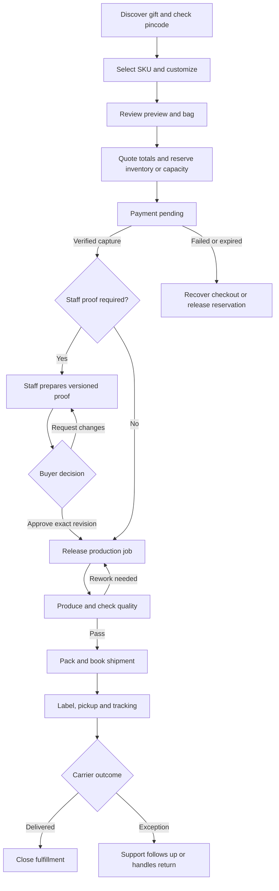

# Aura 11:11 project plan and requirements

Planning baseline updated 19 November 2026. This document brings the project scope, launch features, catalog intake, workflows, architecture, operations, and implementation plan into one place. The individual Markdown files are available for focused edits.

## Contents

- [Project initiation document PID](#project-initiation-document-pid) · [Section file](PID.md)
- [Project decisions](#project-decisions) · [Section file](PROJECT_DECISIONS.md)
- [Product requirements PRD](#product-requirements-prd) · [Section file](PRD.md)
- [Feature register](#feature-register) · [Section file](FEATURES.md)
- [Product catalog and customization](#product-catalog-and-customization) · [Section file](PRODUCT_CATALOG.md)
- [System flow](#system-flow) · [Section file](systemflow.md)
- [Technical requirements TRD](#technical-requirements-trd) · [Section file](TRD.md)
- [Operations](#operations) · [Section file](OPERATIONS.md)
- [Implementation plan](#implementation-plan) · [Section file](IMPLEMENTATION_PLAN.md)
- [Design references and image provenance](#design-references-and-image-provenance)

## Project initiation document PID

**Project.** Aura 11:11 personalized gifting storefront, order operations, and fulfillment.

**Owner and users.** The store owner approves the catalog, commercial rules, providers, and launch readiness. Gift buyers, production staff, support, finance, and fulfillment use the system.

**Scope.** Discovery, product configuration and preview, online payment, proof approvals where required, production, quality checks, packing, shipping, tracking, invoices, refunds, email and WhatsApp, and role-scoped staff and admin workspaces.

**Starting decisions.** Use [Gift Bar](../design/homepage/03-gift-bar-concept.png) and [One of One](../design/homepage/05-one-of-one-concept.png) as the shared storefront design references. Build one sign-in and sign-up portal for all account types and an admin panel for storefront content and catalog operations. Plan for Cashfree checkout and Shop by Arrival Date. Superwallet is a product name pending details, and photo frames are an example category pending confirmation.

**Prerequisites.** Confirm the intended source checkout, launch products and assets, pickup location, service regions, dates and cutoffs, production lead times and proof rules, merchant accounts, and billing and returns policies.

**Release criteria.** Complete a representative standard order and a proof-required order in staging through payment, manufacturing, invoice, and delivery. Confirm permissions, privacy, reliable arrival estimates, recovery, and staff ownership. See the [implementation plan](IMPLEMENTATION_PLAN.md) for phase gates.

## Project decisions

### Confirmed

- On 19 November 2026, the owner chose [Gift Bar](../design/homepage/03-gift-bar-concept.png) for core typography and UI and [One of One](../design/homepage/05-one-of-one-concept.png) for oversized display type and UI patterns across one shared storefront design. Iris is the earlier approved concept in the [design record](../design/homepage/README.md).
- One sign-in and sign-up portal serves customers, admins and staff. Server-side roles determine access. Authorized admins manage storefront appearance, content, navigation and the product catalog from the admin panel.
- The owner will provide the actual products and customization options. The catalog examples in earlier drafts and images are illustrative.
- Planning covers the customer storefront, backend, database, owner/admin and staff panels, delivery, billing, invoices, email and WhatsApp, with local Javali as a reference for operations and integration structure.
- Shop by Arrival Date is approved for the plan. Release it once estimates are validated against production and carrier data.
- Cashfree is the priority checkout integration. Superwallet is a product name supplied by the owner. Its category, assets and customization options await catalog details.

### Proposed and awaiting owner or technical confirmation

| Decision | Working proposal | Confirm before |
| --- | --- | --- |
| Launch products and hero SKU | Enter real SKUs and options in [Product Catalog](PRODUCT_CATALOG.md). Use the shared 03 and 05 design direction with imagery for a real item or an approved hero concept. | Finalizing catalog and 3D asset production |
| Payment flow | Online checkout with Cashfree, with WhatsApp as concierge and support. Confirm whether COD, assisted checkout, or pay links are needed. | Checkout and integration configuration |
| Delivery | Owner will provide pickup location, coverage, dates, cutoffs and nonworking days. Evaluate Shiprocket, Blue Dart and Ekart against real parcel profiles and launch locations. | Accurate quotes, date filtering and labels |
| Proof model | Use product-specific proof policies. Proposed baseline for paid orders is proof before production. Confirm whether any category needs a proof or bespoke quote before payment. | Proof rules and customer copy |
| Pricing and policies | Confirm base and add-on prices, applicable billing/tax inputs, returns, cancellation, remake and refunds, service regions, cutoffs and lead times. | Production catalog and billing |
| Communications | Resend is the email candidate. Confirm sender domain, support number, WhatsApp account/provider and approved templates, and recipient-notification rules. | Live notifications |
| Ownership and access | Confirm active staff roles, sensitive action approval, retention periods, and backup and support owners. | Back-office pilot |
| Technical foundation | Evaluate Next.js plus protected server routes and Supabase against the last Vite baseline or any newer authorized source. Choose hosting after validating runtime, job scheduling, data and 3D delivery needs. | Foundation exit |
| Additional features | Shop by Arrival Date is approved. Revisit bundle builder, repeat orders, milestone reminders and corporate bulk based on catalog and demand. | Scheduling post-launch work |

### Reference history

The [archived PRD](archive/PRD-v2.md), [archived implementation plan](archive/IMPLEMENTATION_PLAN-v1.md), and [earlier redesign blueprint](../aura-11-11-redesign-plan.md) preserve earlier design, WhatsApp-first and architecture proposals. Use the current planning documents for scope and open decisions. The Javali reference informed role boundaries, provider adapters, billing and reconciliation, and operational queues. Aura’s procedures and published policies will be confirmed independently.

## Product requirements PRD

**Status** Planning draft. Gift Bar and One of One are the current design references. The launch catalog, operating policies, and integration choices await confirmation.

### Product goal

Aura 11:11 helps shoppers find a gift, make it personal, see what they are ordering, and understand when it can arrive. Staff need a reliable production brief and clear ownership of the order from payment through delivery. The owner needs control over what is sold, how it can be customized, and what reaches the storefront.

### Users and their needs

| User | Needs |
| --- | --- |
| Gift buyer | Find something appropriate by recipient, occasion, price, or delivery date. Personalize it, approve any required proof, pay, and track it. |
| Gift recipient | Receive the gift and intended note without receiving the buyer’s invoice or seeing prices in gift-facing materials. |
| Production and packing staff | See assigned items, exact approved artwork or text, due dates, packing instructions, and the next allowed action. |
| Support and concierge | Find orders, communicate about proofs or delivery, record exceptions, and request escalations with the appropriate permissions. |
| Owner and admin | Publish catalog and CMS changes, manage staff, oversee inventory, orders, billing, delivery, and exceptions. |
| Finance staff | Reconcile payments and refunds and access approved billing documents and exports. |

### Launch requirements

| ID | Area | Expected behavior |
| --- | --- | --- |
| P01 | Homepage and discovery | Use [Gift Bar](../design/homepage/03-gift-bar-concept.png) typography and layout patterns and [One of One](../design/homepage/05-one-of-one-concept.png) oversized display type and personalization UI. Apply one design system across home and interior pages. Include the 3D hero, gift finder, collections, search, filters, product details and footer. |
| P02 | Product and customization | Show price, variants, availability, supported options, production lead time, and preview or proof expectations. Validate required fields, allowed combinations, image requirements, and additional charges. Let buyers correct their configuration before submitting. |
| P03 | Bag and checkout | Preserve each separately personalized item. Show item prices, add-ons, discounts if enabled, shipping, applicable taxes, and the total. Support guest checkout with distinct buyer, recipient, and billing details as needed. Collect gift note and wrapping choices when enabled. Reconfirm changed price or availability before payment. |
| P04 | Payment and confirmation | Create a server-side order reference and support online payment through the chosen gateway. Handle success, pending, failed, and late outcomes. Show a recoverable status after a redirect or reload and prevent double charge attempts or duplicate fulfillment. |
| P05 | Delivery and tracking | Check recipient pincode and show an estimated arrival range which includes both production and transit. Let shoppers filter by required arrival date once estimates are validated. Show order stage, shipment tracking, and what happens when a carrier cannot deliver. |
| P06 | Proof, production, and QC | For products that need a proof, send a versioned preview and collect the buyer’s approval or revision request. Approve the specific version before production. Capture job assignment, production, quality check, packing, and shipment handover. |
| P07 | Owner and staff panels | Keep an owner/admin workspace and scoped staff workspace. Include catalog, variants, inventory and capacity, personalization templates, CMS, orders, proof tasks, shipment exceptions, billing, reports, and audit history according to permissions. |
| P08 | Billing and support | Give the buyer access to the applicable receipt or invoice. Handle cancellations, refunds, and approved adjustments using policy-driven eligibility. Provide a support path through the order or WhatsApp concierge. |
| P09 | Communications | Send email for core transactional events and support authorized WhatsApp templates where configured. Record delivery outcomes and respect channel preferences. Route proof and order details to the buyer by default. |
| P10 | Accessibility and trust | Shopping and customization work with keyboard, touch, reduced motion, and a static alternative to WebGL. Publish approved delivery, returns, privacy, and contact information. Claims, ratings and prices need real sources. |
| P11 | Shared account portal | Customers, staff and admins sign in through one portal. Public registration creates a customer account. Elevated roles are assigned privately by authorized owners. Return shoppers to their cart or checkout when applicable. |
| P12 | Admin content and catalog | Authorized admins edit backgrounds, hero, navigation, footer, pages, content and approved themes. Manage product, variant and customization lifecycles, including removal from sale and safe deletion. Preview, publish and roll back storefront changes without deploying. |

### Catalog and design boundaries

The examples in old notes and design images illustrate layouts. The owner will supply actual products, options, variants, pricing, stock or capacity, production constraints, and assets using the [catalog intake](PRODUCT_CATALOG.md). Product categories remain draft until intake. Use the shared 03 and 05 style with real catalog imagery, including a hero asset and poster for approved merchandise. See the [design record](../design/homepage/README.md) for the current direction and previous concepts.

### Launch acceptance and measurement

- A buyer can complete a representative standard order and a proof-required order on mobile and desktop, recover after interruption, and see a correct delivery estimate and tracking state.
- A staff member can take assigned work through proof, production, QC, and packing while access stays within their role. The owner can trace one order from placement through payment, billing, and shipment.
- A timed-out or repeated payment, provider event, refund, or shipment retry leaves a single correct business result. A genuine exception appears in an owned work queue.
- Track discovery to checkout, checkout completion, proof turnaround, production delays, delivery exceptions, and support contact rate. Record aggregate funnel events without collecting gift text or private images in analytics. Set target values after a pilot baseline.

### Scope and decisions

[Feature register](FEATURES.md) records launch candidates and suggestions. [Project decisions](PROJECT_DECISIONS.md) lists owner inputs and open choices. Implementation sequencing is in [Implementation Plan](IMPLEMENTATION_PLAN.md).

## Feature register

Launch scope is the planning baseline. Conditional features depend on the operating policies, merchant accounts, or launch catalog in [Project Decisions](PROJECT_DECISIONS.md).

| Area | Launch baseline | Conditional or later |
| --- | --- | --- |
| Storefront | Shared Gift Bar and One of One visual system across home and interior pages, 3D hero with static alternative, collections, search, gift finder, filters, product details, site policies, contact and tracking | Wishlist, reviews from completed purchases, recommendations based on approved catalog tags, localized copy |
| Personalization | Per-product rules, price updates, text and photo preview as needed, private uploads, proof review when required, gift note and wrapping when offered | Bundle builder, saved private drafts, richer live 3D previews by SKU, batch personalization |
| Checkout and account | Shared sign-in and sign-up portal, guest and signed-in checkout, bag, server quote, buyer and recipient details, online payment, confirmation and secure tracking link | Coupons, gift cards, COD for allowed products, international shipping |
| Admin and staff | Owner dashboard, role assignment, admin-managed appearance, homepage, hero, navigation, footer and page editor, product lifecycle, personalization rules, inventory/capacity, work queue, QC, order and shipment exceptions, billing access and audit | CRM milestones, VIP segments, bulk quote management, accountant exports beyond baseline, multi-location stock |
| Delivery | Pincode check, estimate including production, one aggregator integration, shipment booking and labels, tracking, exception triage. Shop by Arrival Date is approved and releases once estimates are validated. | Direct carrier accounts, pickup, reusable schedules, scheduled delivery where supported, split shipments where justified |
| Billing and communications | Payment reconciliation, receipt or invoice lifecycle, refunds, email, WhatsApp concierge and transactional templates where approved | Marketing automation, reminders with opt-in, support inbox integrations, corporate invoicing extensions |

### Suggestions for owner review

| Suggestion | Why it fits Aura | Priority |
| --- | --- | --- |
| Shop by Arrival Date (approved) | Filter to gifts likely to arrive by a chosen date, using pincode, capacity, proof time, working days, cutoffs and transit. Show estimates and recheck at checkout. | Release after delivery estimates are validated |
| Secure proof approval in one tap | Send the buyer to a private proof link where they can approve or request changes. Reduce typo disputes and preserve proof history. | Baseline for proof-required products |
| Gift mode | Separate the recipient from the payer and offer a gift note. Reserve prices, invoice, and proof links for the buyer. | Baseline |
| Private saved customization | Let a buyer resume a draft without re-uploading photos. Offer a time-limited share link only when needed, with explicit access and retention rules. | After launch if shoppers frequently abandon customization |
| Gift Bar bundle builder | Use the retained Gift Bar concept for an optional create-a-set feature. Check component availability, price and packing compatibility before checkout. | Pilot if enough interchangeable products are confirmed |
| Bulk gifting quote inbox | Let corporate buyers upload quantity and branding requirements and let staff issue versioned quotes and proofs. | Pilot if bulk orders are part of the launch business |
| Private gift reveal | Share an optional message with the recipient on a scheduled date. Keep it separate from promised courier arrival and protect private photos. | Later |

## Product catalog and customization

The owner will provide the launch catalog. Start with one entry per sellable product. Rough notes or photos are enough to begin, and the team can structure the entries together.

### Names and ideas received

| Item | Status |
| --- | --- |
| Superwallet | Product name received. Category, photos, variants, price and customization options pending. |
| Photo frames | Example product category. Confirm actual products and supported options when catalog details arrive. |

Use the confirmed descriptions, assets and personalization rules to design the corresponding storefront and product views.

### Product template

| Field | What to capture |
| --- | --- |
| Product | Working name, category, description, occasions and recipients, hero or gallery assets |
| SKU and variants | Variant names and identifiers, material, finish, size, color, sold individually or as a bundle |
| Price | Base price, variant deltas, customization and gift-wrap fees, quantity pricing if applicable, approved tax classification |
| Inventory | Stocked, made to order, or hybrid, per-SKU availability, component requirements for bundles, unit or daily production capacity |
| Personalization | Fields from the table below, where each option applies, which options can be combined, and approved examples |
| Production | Standard/complex lead time, cutoffs, nonworking days, proof requirement, revision policy, QC checks, minimum quantities |
| Shipping | Pickup origin, packed dimensions and weight, fragile or restricted items, allowable shipping modes, delivery exclusions, packing method |
| Returns | Eligible reasons and window, cancellation cutoff, remake or damage policy for this type, owner-approved wording |
| Assets | Product photos, poster, optional 3D file and texture sources, actual font or artwork licenses, sample production output |

### Personalization field template

| Field | What to capture |
| --- | --- |
| Identity | Stable field key and label seen by the buyer |
| Input type | Text, name/initials, date, option selector, color/finish, image, crop, placement, optional gift note, or other method supplied by owner |
| Rules | Required or optional, which variants enable it, characters and line limits, languages and supported glyphs, upload formats, resolution/dimensions, max size, compatibility rules |
| Default | Example content and placeholder media allowed in storefront previews |
| Pricing and time | Additional cost, unit/order pricing, additional lead time, proof policy by field or combination |
| Preview and production | Render surface, font or template version, safe area, output dimensions, final artwork format, approved placement coordinates, fallback behavior |
| Review | Who reviews exceptions, allowable adjustments, what gets reapproved, rejection reasons and customer guidance |

### Proof modes

- **Preview only** for options the buyer can validate in checkout under the product’s approved rules.
- **Staff proof required** when staff need to check a crop, inscription, placement, or other production constraint. Buyer approves a specific revision.
- **Manual quote** for unsupported, bespoke, or bulk configurations. Staff capture a structured quote before a payment request.

### Intake order

1. Send product names and each supported customization option.
2. Confirm prices, variants, materials, stock/capacity, and production lead times.
3. Supply real assets and at least one usable example for each customization method.
4. Confirm proof and shipping rules. Product publication requires usable prices, sellability, active customization rules where needed, and a configured delivery policy.

## System flow

See [PRD](PRD.md) for requirements, [TRD](TRD.md) for contracts, and [Operations](OPERATIONS.md) for staff procedures. This is the proposed operating model.

### Account entry and storefront management

- The shared account portal verifies identity. A new public sign-up receives customer permissions. Invited staff and admins enter their authorized workspace. A customer can return to the bag or checkout, and guest checkout remains available.
- An authorized admin opens a content or product draft, edits it in the panel, and previews it. Publishing validates the draft and updates the relevant storefront pages. Archiving removes a product from future sale. Existing orders keep their saved purchase details.

### End-to-end journey

### Buyer and checkout

1. Shopper browses or filters by gift intent. Early pincode checks indicate coverage and indicative timing. Exact estimates require the chosen items, options, and quantities.
2. For each line, select SKU and customization. Save normalized input, asset references, and template version. Show preview and validation. When the proof is mandatory, clearly explain approval timing and its impact on the estimate.
3. At checkout, capture buyer, recipient, shipping address, billing details if needed, wrap and note, and relevant communication preferences. Server verifies sellability, compatibility, availability, capacity and a delivery quote. Final review distinguishes manufacturing time and transit and shows a total.
4. Create an order and reservation from that quote before creating a gateway session. If payment is pending after return, show the same order reference and refresh status. Retry only after the previous attempt is confirmed safe to retry.
5. Verify the provider outcome and reconcile amount, currency, and order. Finalize paid state once, confirm the reservation, and publish the event. On expiry release the hold if payment has no verified capture. Route a capture after release to reconciliation, then fulfill only after availability is secured or refund is initiated under policy.

### Shop by Arrival Date

Collect destination pincode and required date. Estimate a range from current stock, selected configuration or a conservative default, production capacity, proof time, business days, pickup cutoffs, and carrier transit. Offer the date filter for serviceable products with a credible estimate. Clearly label uncertain or unavailable results and offer alternatives. At checkout, recompute using exact choices and current capacity, and show the buyer immediately if the date has changed. Pause the feature for affected products or regions when reliable estimates are unavailable.

### Proof and production

1. Create production tasks per fulfillment line or group. Staff see the frozen specifications, asset, and target ship date.
2. For proof-required items, staff publish a revision and buyer sees a private approval link. Approving persists order line, revision, timestamp, and actor. A change affecting content or placement creates a fresh proof version and invalidates prior production approval for the new version. A stalled order stays visible for follow-up and a revised ETA.
3. Production records work started and finished. QC compares output against approved artwork or frozen inputs, checks finish, spelling, quantity, and condition. Rework reopens the task. A material spec change requires renewed approval before production.
4. Packing uses the gift note and packaging instructions. Keep buyer-only financial documents separate from gift-facing materials.

### Shipping, billing, and aftercare

1. Record packed weight and dimensions. Create shipment once, capture provider and carrier references, print the label, and request or arrange pickup. Packing, label creation, and actual carrier handover are separate milestones.
2. Reconcile tracking webhooks and scheduled status checks. Expose buyer-safe history and a tracking link. Failed delivery, address correction, lost parcels, return to origin, and damage create assigned exception work. Capture any replacement shipment under its own reference.
3. Issue the applicable receipt or invoice at the milestone approved by finance, using the frozen billed values. A refund has its own request and provider confirmation. Issue an associated credit document where the approved billing policy requires one.
4. Queue transactional notifications on committed business events. A failed send appears in the queue and can be retried without producing duplicate messages. Keep recipient messages limited to intended delivery communications.
5. Buyer opens a secure tracking or support link. Support records a request and routes it to the team with authority. Policy controls cancellation, remake, replacement and refund eligibility.

### State ownership

| Track | Example progression | Owns the change |
| --- | --- | --- |
| Payment | Pending → captured / failed / expired → refund pending → partial or fully refunded | Payment verification and reconciliation, with scoped finance actions |
| Proof per line | Not needed / awaiting proof → awaiting buyer → revision requested or approved | Staff submits, buyer approves specific revision |
| Production per line | Queued → in progress → QC → passed or rework → packed | Assigned production and packing staff |
| Shipment per parcel | Unbooked → label ready → handed over → in transit → delivered or exception / returned | Shipping workflow and verified carrier events |
| Invoice | Pending → issued → adjustment document where applicable | Billing workflow and authorized finance |
| Notification | Queued → submitted → delivered when known, retry scheduled, or failed | Outbox worker and verified provider updates |

Customer order status is a projection of these tracks. Proof and production can differ by line. A shipment update cannot change payment or proof state. Cancellation and refund may resolve at different times. Follow explicit rules for mixed orders and expose customer-friendly summaries.

## Technical requirements TRD

**Status** Proposed architecture. Provider account capabilities, deployment runtime, and applicable billing policy will be verified during implementation before production configuration.

### Architecture and ownership

- **Web**. A TypeScript React storefront, admin shell, and staff shell backed by server handlers. Evaluate Next.js for one deployment with indexable catalog routes and protected handlers. The historic baseline used Vite; if retained after code audit, pair it with an explicit server API that has the same trust boundaries. Decide at foundation before feature work.
- **Design system**. Build one shared theme and component library across storefront routes from 03 Gift Bar and 05 One of One. Use core display, large condensed display, and UI typography roles with licensed fonts. Candidate hero uses Three.js with optimized GLB and lazy loading. Deliver a static poster before WebGL, accessible controls for view selection and rotation, and honor reduced motion.
- **Data**. Proposed Supabase/Postgres for durable commerce, one Auth identity system for customers, admins and staff, and object storage for media. Keep customer uploads, proofs, billing documents and exports private. Public product media can use a separate published media area.
- **Server and workers**. Server owns pricing, stock/capacity, permissions, immutable purchase snapshots, transitions, provider credentials, and webhook receipt. A jobs worker consumes durable events for notifications, expiring holds, reconciliation, label retries, tracking refresh and cleanup. Monitor health and failures.
- **Providers**. Cashfree is planned for checkout. Keep payment, shipping, email and WhatsApp behind capability-specific interfaces. Evaluate Shiprocket for shipment operations, Blue Dart and Ekart through available accounts or integrations, Resend for email, and an approved WhatsApp Business provider. Keep the provider identity on each record for reconciliation. Store credentials in server-side environment or deployment secrets.

### Backend location

This checkout has no verified deployed Aura backend. The historical commit shows a Vite storefront. Javali is a separate reference project. The proposed Aura backend lives in this repository as protected server routes and server-only commerce modules. If Next.js is selected, use `app/api/` for handlers and `src/server/` for business logic and adapters. Keep database changes under `supabase/migrations/` and jobs in a server-side worker, with the deployment and scheduling location decided in foundation. If Vite is selected, put the API and worker in a separate server package in this repository.

### Data requirements

| Domain | Entities and invariants |
| --- | --- |
| Catalog and CMS | Product, variant/SKU, collection, product media, page/section/menu revisions, theme preset, publish pointer, pricing and configuration template version. SKUs have stable identities and changed published slugs preserve redirects. Historical orders retain their purchase snapshots. |
| Inventory and production capacity | Stock movement ledger, reservation, component/BOM rules where needed, capacity calendar. Keep time-bound holds and prevent oversell with atomic reservation updates and constraints. |
| Cart and quote | Cart, line, selected options, shipping estimate and quote expiry. Revision checks prevent stale edits. Quotes carry fulfillment assumptions and amounts in integer minor units with currency. |
| Order and people | Order, immutable priced line snapshot, frozen customization, buyer contact, recipient and shipping snapshot, gift note, status history. Keep minimal customer and recipient data separately where access differs. |
| Personalization | Template versions, upload records, preview metadata, proof revisions, approvals, production artifact and job. Store object keys and ownership, retain only according to approved policy. |
| Payment and billing | Attempts, provider references, authorized adjustments, refunds, invoice and credit document snapshots, reconciliation records. Use unique provider event/reference constraints and idempotent side effects. Preserve issued record and audit history. |
| Delivery and messages | Shipment and package, booking attempt, carrier/AWB, tracking event, notification preference, outbox and message attempt. Order-to-shipment relationship allows future multiple parcels. |
| Access and audit | Staff identity, role, assignment, customer consent, audit events and state timelines. Store actor, action, scope and reason for privileged changes, with sensitive fields redacted. |

### Internal interface sketch

| Interface | Contract |
| --- | --- |
| Catalog and search reads | Public published data and allowed choices. No costs, supplier notes, private assets, or stale unpublished prices in responses. |
| Shared authentication | Public sign-up assigns customer access. Owner-authorized invitations grant staff and admin roles. Resolve roles server-side and validate checkout return destinations. Recheck access on privileged requests and after role revocation. |
| Content publishing | Preview drafts privately. Validate assets and structure, publish the new version atomically, invalidate changed pages and search entries, and audit the actor and version. Rollback republishes a valid previous version. |
| Catalog mutations | Recheck permissions and dependencies before publish, archive, restore or delete. Permanent deletion applies to unused drafts. Reject archived SKUs when repricing an active cart and preserve historical orders and issued documents. |
| Customization and media | Issue restricted upload capability and validate type, dimensions, size, authorization and scan state before use. Render using template version and normalized fields. Return actionable validation errors. |
| Quote and checkout | Inputs are SKU, configuration references, quantities, destination and permitted incentive code. Server returns authoritative price breakdown, ETA, quote version and expiry. Checkout mutations carry idempotency keys, and repeat submissions return the prior result for the same input. |
| Order and proofs | Authenticated account or private signed opaque customer link with expiry and revocation. Approval uses an expected revision and rejects stale versions. Sensitive URLs excluded from analytics and logs. |
| Ops actions | Server-checked permission and assignment. Update via explicit transitions with expected prior state or version. Financial and privilege changes require an audit reason and prescribed approvals. |
| Provider webhooks | Authenticate against the selected provider contract, persist a deduplicated event before acknowledgment, verify critical fields, and reconcile missing/out-of-order events. Use shared finalization for webhook and return verification. |
| Outbox | Write business event and outbox record in the same transaction. Worker leases due attempts, uses stable dedupe keys, records results and handles retry, exhausted attempts and manual review. For unknown external outcomes reconcile before repeating side effects. |

### Privacy and security

Use least-privilege roles and server enforcement on each back-office request. Apply DB access policies as appropriate and test for cross-order and cross-role access. Keep admin credentials server-side. Restrict private upload downloads with scoped, expiring links. Validate real media, remove unneeded metadata where safe, and clean abandoned uploads on an approved schedule. Rate-limit public writes and access-token verification. Redact PII, private images, notes and payment data in logs and analytics. Require staff MFA where supported. Use payment-provider checkout so Aura does not handle raw card data. Define retention, deletion exceptions and restore access before launch.

### Reliability and verification

- Unit-test pricing, option compatibility, capacity and ETA calculations, state projections, role rules and message triggers.
- Integration-test concurrent checkout, stale quotes, duplicate and delayed provider callbacks, expired reservations with a late capture, upload isolation, stale proof approvals, rework, repeated refund attempts and shipment retry.
- Browser-test standard/review orders, keyboard/touch and slow mobile, reduced motion, no-WebGL fallback, staff access, and buyer/recipient privacy. Confirm public pages expose approved metadata and assets.
- Staging fixtures simulate all providers before production onboarding. Close one test order from quote through proof, invoice, shipment and refund. Exercise backup restoration and production rollback. Capture deployment metrics including failed jobs, stuck proofs, pending payments, shipping exceptions and delivery estimates.

## Operations

The admin and staff areas share the same order record and event history. Their screens and allowed actions reflect each role.

### Workspaces and permissions

| Role | Views and actions |
| --- | --- |
| Owner | All queues and reporting. Staff invitations and role assignments, integration readiness, policy and settings, audit review, escalation and approvals. |
| Admin / merchandising | Manage catalog, SKU availability, pricing, allowed customization, CMS draft and publication, appointments or deadlines where enabled, and operations oversight. Separate permission for refunds, credential management, and sensitive exports. |
| Concierge / support | Search buyer orders and see permitted contact and delivery details. Record notes, handle proof questions and delivery exceptions, request changes, remake or refund. Send approved messages from the order record. |
| Production and QC | View assigned work, needed inputs and proofs, priority and due date. Prepare proofs, log production, check output, hold or rework jobs. Prices, accounting and unrelated customer data are outside this role. |
| Packing / fulfillment | See packing checklist, gift note, recipient label data, package dimensions, pickup, and carrier handover. Escalate damage or booking exceptions. |
| Finance | Review captures, settlements, refunds, billing documents and exports. Approve or issue adjustments under configured authority. |

All users enter through the same account portal. The owner invites staff and assigns roles. After sign-in, each role has access to its permitted workspace and actions. Log role changes, approver, time and reason. Deactivation ends staff access.

### Storefront and catalog publishing

Authorized admins manage themes, homepage wallpaper, hero, navigation, footer, pages and product data from the admin panel. Preview drafts at mobile and desktop widths, publish when approved, and use version history to restore earlier content. Archive products that leave the catalog and preserve purchases, proofs and invoices. Refer to the [implementation plan](IMPLEMENTATION_PLAN.md) for the full editing scope.

### Daily queues and handoffs

| Queue | Trigger and next action |
| --- | --- |
| Payment follow-up | Pending beyond the expected window, mismatched amount, late capture or ambiguous outcome. Finance reconciles and authorizes next step. |
| Proof review | Proof-required paid line. Staff submits revision, buyer approves or requests changes. Concierge follows overdue approvals and refreshes estimates. |
| Production and QC | Approved or preview-only paid line. Staff validates source file, produces, checks quantity and compares artwork. Failures go to rework with reason. |
| Packing and shipping | QC-passed items. Check wrap, note, SKU, address label, weight and dimensions. Book once, verify label and mark actual handover. |
| Delivery exceptions | Failed delivery, address issue, return to origin, lost or damaged parcels. Support records carrier contact, buyer communication, replacement or refund decision. |
| Billing / message failures | Failed invoice generation, refund reconciliation, missing templates or exhausted sends. Review the original transaction or provider receipt before retrying. |

### Notifications and billing

| Event | Audience and channel |
| --- | --- |
| Paid order or confirmed failure | Buyer email, with optional configured WhatsApp status link. Leave sensitive details on the private order page. |
| Proof ready, change request or approval | Buyer gets proof link when ready. Assigned staff see revision and approval events in the work queue. |
| Delay, dispatch and tracking | Buyer by email and opted-in/eligible WhatsApp where available. Recipient receives only the delivery details configured for recipient notification. |
| Receipt or invoice, refund or credit | Buyer via private document link or the approved delivery method. Finance sees issue, reconciliation and error states. |
| Operational exception | Assigned staff queue. Escalate unresolved high-priority items to owner or finance as applicable. |

Admin configures approved templates and sender identity. Record template version and event delivery status, and include retry and suppression rules. Keep marketing subscription separate from order communications. Collect only appropriate permissions and preferences, including recipient handling. Finance supplies invoice issue timing, merchant details, numbering rules, tax and reconciliation inputs before any production invoice. No order-related pricing is printed on a recipient gift note.

### Release and ongoing operations

- Configure staging then production merchant accounts, approved sender identities, callback destinations, pickup origin, package types, and serviceability defaults. Verify provider event contracts in test environments.
- Configure availability, nonworking days, cutoffs, order policies, proof time, vendor contact path and responsible staff. Test estimates against sample destinations and fragile or oversize products.
- Monitor unresolved payments, aged proofs, production backlog, delayed carrier handover, delivery exceptions and failed notifications. Use alerts with an owner and actionable links.
- Document backup and restore cadence, allowed operators, environment rollback, and provider outage procedures. During a provider outage, show an honest pending or unavailable state and reconcile queued events on recovery.
- Reconcile money and shipment records against providers on an agreed operational cadence. Resolve mismatches with traceable adjustments.

## Implementation plan

**Status** Planning baseline updated 19 November 2026. This plan defines the shared storefront style, account portal, and admin-managed storefront and catalog. Confirm the intended source checkout before application work. The present working tree has pre-existing tracked application deletions.

### One storefront design across all pages

| Reference | What to build from it |
| --- | --- |
| [03 · Gift Bar](../design/homepage/03-gift-bar-concept.png) | Use the heavy geometric headline style, readable body and navigation type, compact gift finder, photo-led product grid, solid buttons, and grounded footer. Use its warm paper, forest, marigold, and mint as the initial theme preset. |
| [05 · One of One](../design/homepage/05-one-of-one-concept.png) | Use oversized condensed display typography for the homepage hero and selected editorial headings. Borrow the compact personalization rail for initials, swatches, product controls, and the main action. |
| [Design record](../design/homepage/README.md) | Keep previous mockups as reference history. Use approved catalog photography and 3D assets for the actual products. |

The PNGs are visual references. Match their letterforms with licensed fonts during implementation. Use three shared typography roles: broad, bold headings from 03, condensed display type from 05, and readable UI and body text. Keep display type responsive so long titles wrap and product imagery does not obscure the heading.

Use one component library and shared theme for the homepage, search, collections, product details, customization, bag, checkout, sign-in, account, tracking, help and policies. Interior pages use the same typography, buttons, links, inputs, spacing, image treatment, header and footer. Checkout and account screens can use simpler layouts while keeping the same visual system. Back-office screens reuse the typography and controls at a higher density suitable for tables and work queues.

### One account portal

1. Build a shared `/auth` entry for sign-in, customer sign-up, account verification, password reset, and sign-out. Customers, staff, and admins use the same authentication service and entry point.
2. Give public sign-ups customer permissions by default. An authorized owner invites staff and grants elevated roles. Resolve roles on the server and route users to their customer account, intended checkout, admin or staff workspace as permitted. A staff account can use its ordinary customer capabilities where appropriate.
3. Keep checkout on the storefront. Support the existing guest checkout plan and return signed-in customers to their bag or checkout without losing personalization. Validate any return destination and handle expired sessions consistently.
4. Check permissions on every protected read and write, including direct URL and API access. Role removal must end back-office access. Cover registration, invitation, logout, session expiry, reset, safe checkout return, and cross-account/role boundaries in end-to-end tests.

### Admin panel and editable storefront

| Admin area | Editable controls |
| --- | --- |
| Appearance | Homepage wallpaper or background image and color, desktop/mobile variants, crop or focal point, overlay, alt text where meaningful, and approved sitewide theme and typography presets. |
| Homepage and hero | Headline, supporting copy, CTA labels and links, image or video, approved 3D asset and poster, featured product, section visibility and order, gift finder labels, product groupings and editorial blocks. |
| Navigation and footer | Logo and site identity assets, menu labels and links, grouping, order and visibility, announcement bar, footer columns, contact and social links. |
| Pages and search metadata | Create or edit campaign, category, help and policy pages using shared templates. Edit slugs, titles, body blocks, media and SEO metadata. Maintain redirects for moved live pages. |
| Catalog | Add, duplicate, edit, preview, publish, unpublish, archive and restore products, collections and variants. Edit SKU, descriptions, photography and 3D media, pricing, inventory or made-to-order capacity, shipping profile, tags and merchandising placement. |
| Personalization and gifting | Manage allowed options per variant, labels, input rules, swatches, fonts and uploads, price and lead-time adjustments, proof requirements, preview templates, gift wrap and notes. |
| Store operations | Manage supported delivery regions, calendar/cutoffs, operating copy, transactional templates and operational settings according to role. Finance and staff functions remain permission-scoped. |

All day-to-day configurable storefront content and catalog changes go through authorized admin screens without a code change or redeploy. Offer structured fields and approved presets to keep the mini pages consistent and accessible. Credentials, application code, financial records, and order history follow their existing protected workflows.

#### Publishing and deletion

- **Content**. Save drafts, preview at desktop and mobile sizes, validate links and required assets, then publish a version. Support rollback, audit history, and conflict detection for concurrent changes. Public pages and search use published values. Refresh affected routes and indexes after publishing.
- **Products**. An admin can remove a product from sale by unpublishing or archiving it. Restore is available. Offer permanent deletion only for an unused draft with no dependent records. Check menu, homepage, collection, bundle, and active cart references. Require confirmation for deletion and retain the audit record. Preserve order snapshots, proof history and invoices for previous purchases.
- **Acceptance**. An authorized admin can change the wallpaper, hero, navigation and footer, create a page and product, edit variants and customization, then preview, publish, and roll back. An archived product stops accepting new orders while past purchases remain readable. Customer and unprivileged staff sessions cannot call any admin mutation.

### Sequencing and acceptance

| Phase | Deliverables | Exit criteria |
| --- | --- | --- |
| 0 · Scope and catalog | Confirm source baseline, launch SKUs, options, hero asset, lead times, policy owners, delivery inputs and provider accounts. | Pilot products have real media and production rules. Record owner decisions in the [decision log](PROJECT_DECISIONS.md). |
| 1 · Foundation and shared auth | Confirm framework and hosting, set up staging, DB migrations, shared authentication, server permissions, component tokens, audit, secrets and CI. | New sign-ups have customer permissions. Invited admins and staff land in the correct workspace. Direct access and role revocation tests pass. |
| 2 · Storefront and content editor | Shared page templates and components, homepage and 3D fallback, discovery and product views, admin editors for content, navigation, appearance and assets. | All storefront routes use the same design on mobile and desktop. An admin can preview, publish and restore content without deploying. |
| 3 · Catalog and personalization | Product and variant lifecycle, collection editors, inventory/capacity, configurable options, media privacy, previews, cart persistence. | Create, publish, edit, archive and restore representative SKUs. Removal keeps historical orders readable. Invalid options get clear errors. |
| 4 · Checkout and finance | Guest and signed-in checkout, server quote and delivery estimate, Cashfree integration, reservations, verification, invoices, refunds and reconciliation. | Both checkout paths work in sandbox. Duplicate and late payment events, failed payments, refunds and changed quotes leave one traceable result. |
| 5 · Atelier and staff | Staff work queues, proof revisions, production, QC/rework, packing, permissions and exception handling. | A proof-required order reaches packing with the correct approved version. Unauthorized staff cannot access unrelated data or privileged actions. |
| 6 · Shipping and communications | Shipment booking, labels, tracking, delivery exceptions, email and approved WhatsApp flows. Validate the arrival-date filter against sample routes and production schedules. | Tracking and notifications use the intended buyer/recipient information. Retries are safe. Enable Shop by Arrival Date when estimates are dependable. |
| 7 · Launch readiness | Acceptance testing, accessibility and performance checks, restore drill, reconciliation, staff training and staged release. | Owner signs off on catalog, editable content and policies. Finance checks billing. Staff complete representative end-to-end orders. |

Build against isolated fixtures while actual product details arrive. Before enabling payments, billing, or delivery, verify provider capabilities against current official documentation and the selected merchant accounts. Use AgyLite planning and verification to track phase acceptance.

## Design references and image provenance

[Gift Bar](../design/homepage/03-gift-bar-concept.png) supplies the main typography and UI. [One of One](../design/homepage/05-one-of-one-concept.png) supplies oversized display typography and personalization controls. Use both in a shared storefront design across all pages. The [design record](../design/homepage/README.md) retains Iris and the other explorations.

The design direction used ideas from the local [Salty](../salty-design.md), [Vaaree](../vaaree-design.md), [Oye Happy](../oyehappy-design.md), [FNP](../fnp-com-DESIGN.md), and [IGP](../igp-com-DESIGN.md) Markdown files and the [earlier Aura design synthesis](../aura-11-11-redesign-plan.md). They informed the fashion-style presentation, curated grid, personalization, pincode UX, and hamper selection. The first beige draft used the earlier local Aura mockup as an image reference. Iris and the later concepts were generated from written prompts. The mockups show intended interaction states. Product images and actual storefront customization will be based on the approved catalog.
