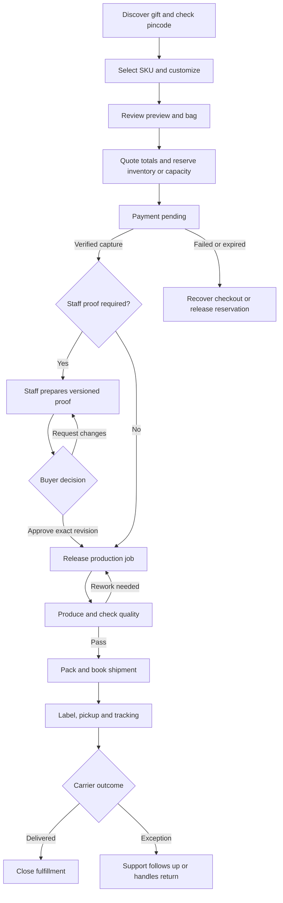

# Aura 11:11 system flow

See [PRD](PRD.md) for requirements, [TRD](TRD.md) for contracts, and [Operations](OPERATIONS.md) for staff procedures. This is the proposed operating model.

## Account entry and storefront management

- The shared account portal verifies identity. A new public sign-up receives customer permissions. Invited staff and admins enter their authorized workspace. A customer can return to the bag or checkout, and guest checkout remains available.
- An authorized admin opens a content or product draft, edits it in the panel, and previews it. Publishing validates the draft and updates the relevant storefront pages. Archiving removes a product from future sale. Existing orders keep their saved purchase details.

## End-to-end journey

## Buyer and checkout

1. Shopper browses or filters by gift intent. Early pincode checks indicate coverage and indicative timing. Exact estimates require the chosen items, options, and quantities.
2. For each line, select SKU and customization. Save normalized input, asset references, and template version. Show preview and validation. When the proof is mandatory, clearly explain approval timing and its impact on the estimate.
3. At checkout, capture buyer, recipient, shipping address, billing details if needed, wrap and note, and relevant communication preferences. Server verifies sellability, compatibility, availability, capacity and a delivery quote. Final review distinguishes manufacturing time and transit and shows a total.
4. Create an order and reservation from that quote before creating a gateway session. If payment is pending after return, show the same order reference and refresh status. Retry only after the previous attempt is confirmed safe to retry.
5. Verify the provider outcome and reconcile amount, currency, and order. Finalize paid state once, confirm the reservation, and publish the event. On expiry release the hold if payment has no verified capture. Route a capture after release to reconciliation, then fulfill only after availability is secured or refund is initiated under policy.

## Shop by Arrival Date

Collect destination pincode and required date. Estimate a range from current stock, selected configuration or a conservative default, production capacity, proof time, business days, pickup cutoffs, and carrier transit. Offer the date filter for serviceable products with a credible estimate. Clearly label uncertain or unavailable results and offer alternatives. At checkout, recompute using exact choices and current capacity, and show the buyer immediately if the date has changed. Pause the feature for affected products or regions when reliable estimates are unavailable.

## Proof and production

1. Create production tasks per fulfillment line or group. Staff see the frozen specifications, asset, and target ship date.
2. For proof-required items, staff publish a revision and buyer sees a private approval link. Approving persists order line, revision, timestamp, and actor. A change affecting content or placement creates a fresh proof version and invalidates prior production approval for the new version. A stalled order stays visible for follow-up and a revised ETA.
3. Production records work started and finished. QC compares output against approved artwork or frozen inputs, checks finish, spelling, quantity, and condition. Rework reopens the task. A material spec change requires renewed approval before production.
4. Packing uses the gift note and packaging instructions. Keep buyer-only financial documents separate from gift-facing materials.

## Shipping, billing, and aftercare

1. Record packed weight and dimensions. Create shipment once, capture provider and carrier references, print the label, and request or arrange pickup. Packing, label creation, and actual carrier handover are separate milestones.
2. Reconcile tracking webhooks and scheduled status checks. Expose buyer-safe history and a tracking link. Failed delivery, address correction, lost parcels, return to origin, and damage create assigned exception work. Capture any replacement shipment under its own reference.
3. Issue the applicable receipt or invoice at the milestone approved by finance, using the frozen billed values. A refund has its own request and provider confirmation. Issue an associated credit document where the approved billing policy requires one.
4. Queue transactional notifications on committed business events. A failed send appears in the queue and can be retried without producing duplicate messages. Keep recipient messages limited to intended delivery communications.
5. Buyer opens a secure tracking or support link. Support records a request and routes it to the team with authority. Policy controls cancellation, remake, replacement and refund eligibility.

## State ownership

| Track | Example progression | Owns the change |
| --- | --- | --- |
| Payment | Pending → captured / failed / expired → refund pending → partial or fully refunded | Payment verification and reconciliation, with scoped finance actions |
| Proof per line | Not needed / awaiting proof → awaiting buyer → revision requested or approved | Staff submits, buyer approves specific revision |
| Production per line | Queued → in progress → QC → passed or rework → packed | Assigned production and packing staff |
| Shipment per parcel | Unbooked → label ready → handed over → in transit → delivered or exception / returned | Shipping workflow and verified carrier events |
| Invoice | Pending → issued → adjustment document where applicable | Billing workflow and authorized finance |
| Notification | Queued → submitted → delivered when known, retry scheduled, or failed | Outbox worker and verified provider updates |

Customer order status is a projection of these tracks. Proof and production can differ by line. A shipment update cannot change payment or proof state. Cancellation and refund may resolve at different times. Follow explicit rules for mixed orders and expose customer-friendly summaries.
